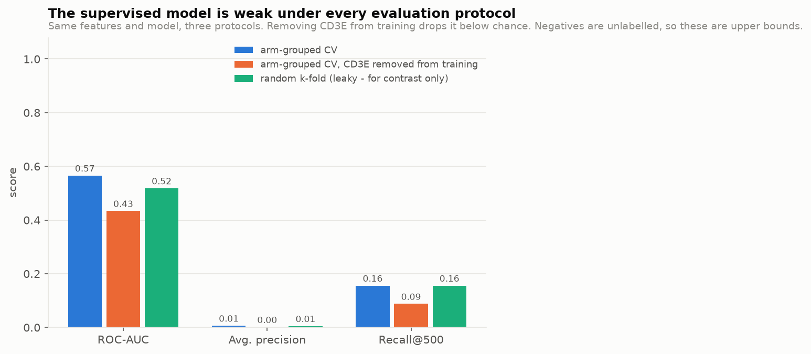
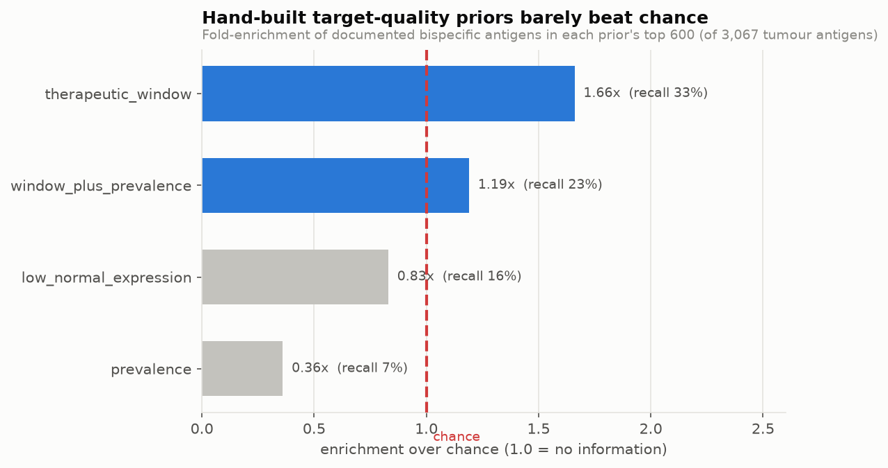
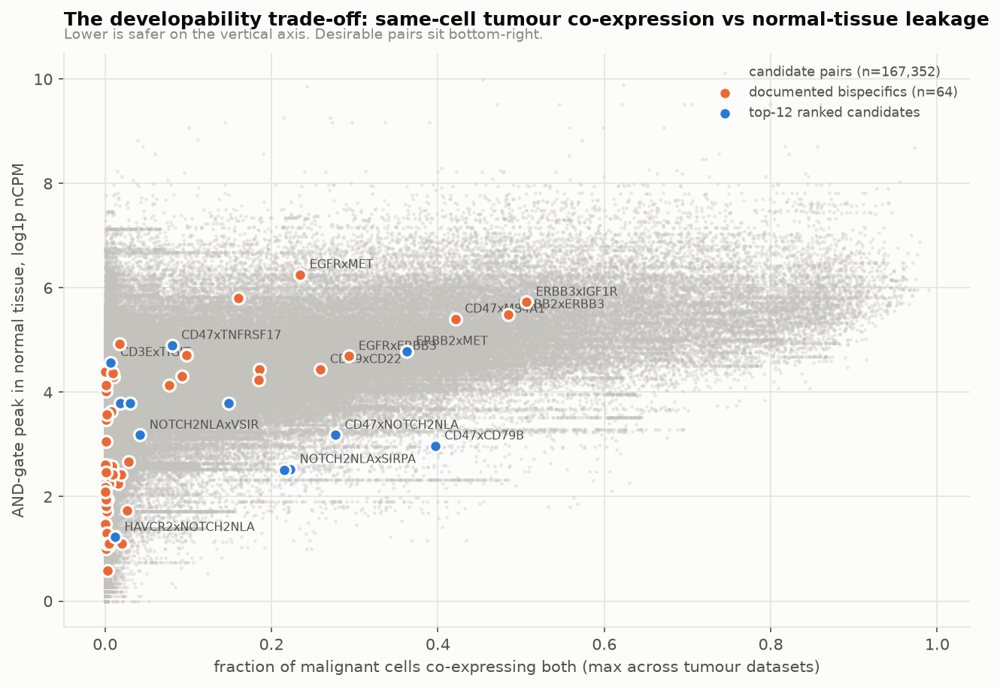
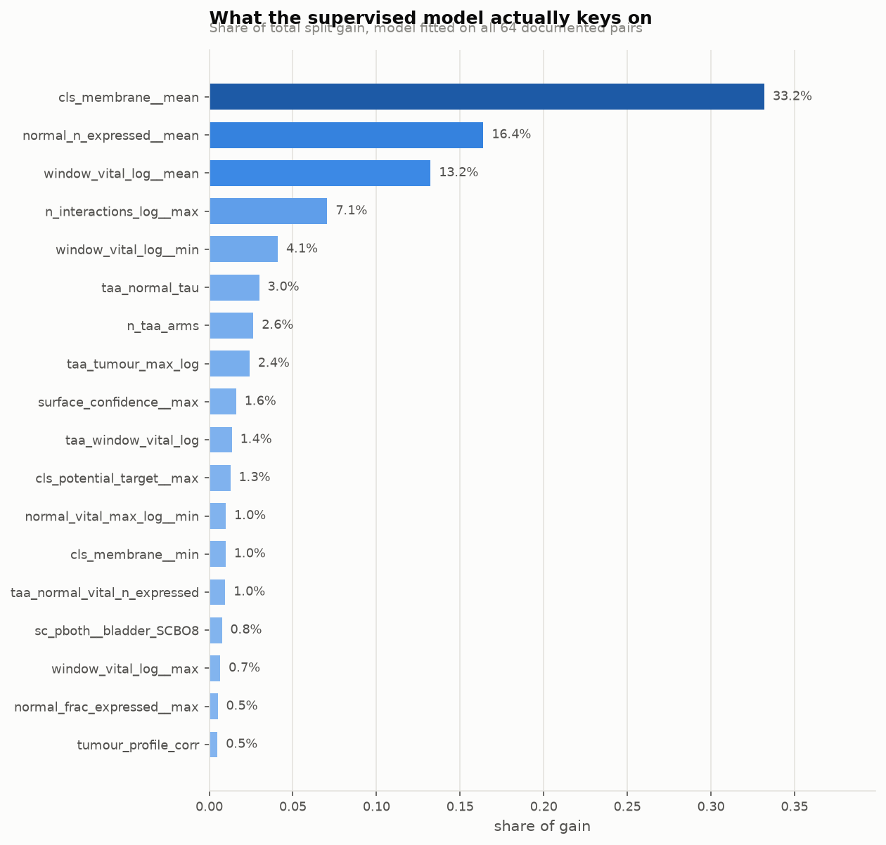
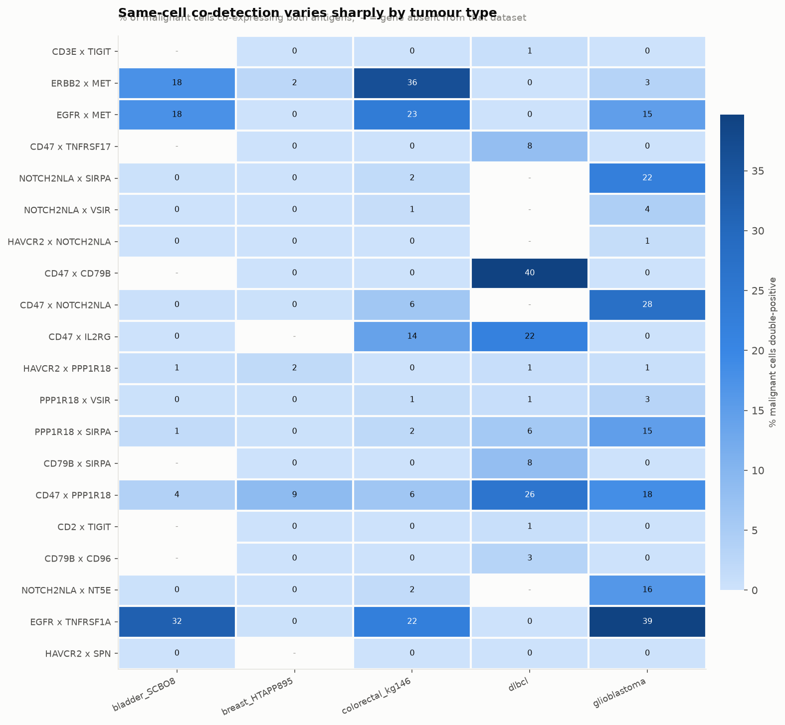

# Predicting bispecific-antibody target pairs

A reproducible pipeline that ranks two-target combinations for bispecific antibody development, built on public single-cell and tumour expression data. This document reports what the method does, what it found, and - at some length - where it does not work.

## Summary of findings

- Built a candidate space of **169,532 target pairs** over **3,091 antibody-accessible genes** (3,067 tumour antigens, 24 immune anchors).
- Measured same-cell co-expression directly in **47,061 malignant cells** across 5 tumour scRNA-seq datasets (urinary bladder cancer, breast cancer, colorectal cancer, diffuse large B-cell lymphoma, glioblastoma).
- **Negative result that shaped the design:** hand-built target-quality priors are close to chance at recovering known bispecific antigens. The best (`therapeutic_window`) reaches only **1.66x enrichment**, and two of four priors score *below* chance. Expression contrast alone does not identify validated targets, so no such prior was used to narrow the search.
- The role-aware rubric places documented pairs at a median percentile of **0.712**, with **26.49x enrichment in the top 500** (ROC-AUC 0.6206 against unlabelled negatives).
- **The two dual-antigen rationales behave completely differently.** Scoring dual-TAA pairs on pathway redundancy gives ROC-AUC **0.8249**; scoring the same pairs on AND-gate selectivity gives **0.3527** - *below* chance. Historical dual-TAA bispecifics were built to block signalling redundancy, not to exploit tumour-selective AND-gating, so the latter has no validation set at all (see below).
- **The supervised model is weak under every protocol** (ROC-AUC 0.518-0.566), and the transparent rubric beats it. Notably, random k-fold did **not** inflate the headline here (random 0.518 vs arm-grouped 0.566) - the leakage effect this project was built to guard against did not materialise on this data, and saying so matters more than keeping a tidy story.
- **The decisive failure is generalisation to unseen arms.** With every CD3E pair removed from training, the model drops to ROC-AUC **0.434** - below chance. Asked to find a good pair of a kind it was never shown, it does worse than guessing. That is the question a discovery team actually has, and it is the strongest argument for the declared rubric over the learned model.

## The problem

A bispecific antibody binds two targets at once. In oncology the pairing usually does one of a few jobs: hold a tumour antigen next to an effector-cell receptor so cytotoxic cells are redirected to the tumour; localise checkpoint blockade to the tumour; or hit two tumour antigens to raise avidity and close off escape. Given a few thousand antibody-accessible proteins there are millions of possible pairs, and the question is which deserve laboratory work.

Two requirements decide it, and they pull in opposite directions. **Efficacy** needs both antigens present on the *same* tumour cell - a pair split across different cells cannot form the required bridge. **Safety** is governed by whichever normal tissue also carries both, because for a bispecific requiring dual engagement the exposure in a tissue scales with the *lesser* of the two antigens, not with either alone. That asymmetry is the whole point of pairing: a target too widely expressed to use on its own can become usable when gated against a second one.

## Data

| Source | Content | Role |
|---|---|---|
| Human Protein Atlas, single-cell atlas | 20,151 genes x 154 normal cell types (nCPM) | normal-tissue safety |
| Human Protein Atlas, cell lines | 20,151 genes x 1,206 cancer cell lines (nTPM), 25 cancer types | tumour expression |
| Human Protein Atlas, annotations | protein class, subcellular location, secretome, specificity | antibody accessibility |
| CELLxGENE tumour scRNA-seq | 5 datasets, malignant + microenvironment cells | same-cell co-expression |
| Curated reference list | 64 documented bispecific pairs (approved / clinical) | positive labels |

Single-cell datasets used:

| dataset          | disease                       |   malignant_cells |   other_cells |   universe_genes_present |
|:-----------------|:------------------------------|------------------:|--------------:|-------------------------:|
| bladder_SCBO8    | urinary bladder cancer        |             10946 |             0 |                     2575 |
| breast_HTAPP895  | breast cancer                 |              6913 |          3045 |                     2836 |
| colorectal_kg146 | colorectal cancer             |              3351 |             0 |                     3060 |
| dlbcl            | diffuse large B-cell lymphoma |             24760 |         14953 |                     2972 |
| glioblastoma     | glioblastoma                  |              1091 |          2498 |                     3057 |


## Method

**Candidate universe.** Antibody-reachable genes showing some tumour expression (>= 10% of cell lines positive in at least one cancer type): 3,091 genes. Immune anchors and the antigens used in documented bispecifics are retained regardless.

Reachability needs care, and getting it wrong was the most consequential bug in this project. HPA's "Predicted membrane proteins" class is a *topology* call: it fires for every organelle membrane. An earlier version used it directly and the top-ranked candidates came back dominated by proteins no antibody can bind in a living cell - mitochondrial ATP-synthase subunits (ATP5MJ, ATP5MK), ER enzymes (VKORC1, the warfarin target; PDIA6), and lysosomal GILT (IFI30). The filter now grades reachability:

- **high** - positive surface or extracellular evidence: plasma-membrane localisation, secretion, CD marker, or GPCR
- **medium** - predicted membrane protein with no contradicting organelle evidence
- **none** - excluded, including anything whose only localisation evidence is an intracellular organelle

The grade is also a scored feature, so high-confidence targets outrank merely-plausible ones rather than the distinction being lost at the filter. **Audited against the validated targets:** of 56 antigens used in documented bispecifics, 33 grade high, 13 medium, and 10 would be rejected outright (CLDN6, DLL4, FOLH1, GUCY2C, LGR5, PMEL, ROR1, STEAP1, TIGIT, TPBG) - an 18% false-negative rate, driven by targets that simply lack reliable immunofluorescence data in HPA. Those six are retained here only because the reference list names them, which is a real limit on the filter's recall for genuinely novel targets.

**Pair space.** Bounded structurally rather than by a quality prior, because the priors were measured to be uninformative: every tumour antigen x every immune anchor, anchor x anchor, and tumour antigen x tumour antigen among the 400 most prevalent antigens. Total 169,532 pairs, containing all 64 documented pairs.

**Features.** Each pair carries symmetric aggregates (min / max / mean / absolute difference) of 35 single-arm features, so no feature can encode arm order, plus genuinely pairwise quantities: AND-gate peaks in normal and tumour tissue, double-positive counts, profile correlations, functional-term overlap, and single-cell co-detection. 202 features in total.

**Ranking.** The primary ranking is a declared rubric of percentile components with fixed weights, not a fitted model. Components a pair has no data for are dropped and the remaining weights renormalised, so an unmeasured pair is not penalised as though it had been measured and found wanting; `coverage` records how much of the rubric was available.

Critically, **the rubric is split by design class**, because the arms of a bispecific are not interchangeable and the classes are not judged on the same evidence. An earlier single symmetric rubric scored *below chance* (ROC-AUC 0.43) for exactly this reason: it rewarded same-cell co-expression for every pair, but in a T-cell engager the effector arm is supposed to be on T cells and absent from tumour, so same-cell co-detection is near zero by design. That metric was penalising the dominant class of real bispecifics. Scores are percentiles *within class*, and the primary outputs are per-class rankings - a single global ordering would imply a comparability that does not exist.

| design_class          | rationale                   | component                     |   weight | feature                    | higher_is_better   |
|:----------------------|:----------------------------|:------------------------------|---------:|:---------------------------|:-------------------|
| TAA|effector          | effector_engager            | tumour_prevalence             |    0.220 | taa_tumour_best_frac       | True               |
| TAA|effector          | effector_engager            | tumour_expression             |    0.120 | taa_tumour_max_log         | True               |
| TAA|effector          | effector_engager            | breadth_across_cancers        |    0.080 | taa_tumour_n_types_hit     | True               |
| TAA|effector          | effector_engager            | window_vs_vital_tissue        |    0.180 | taa_window_vital_log       | True               |
| TAA|effector          | effector_engager            | vital_lineage_safety          |    0.160 | taa_normal_vital_max_log   | False              |
| TAA|effector          | effector_engager            | normal_breadth_safety         |    0.100 | taa_normal_frac_expressed  | False              |
| TAA|effector          | effector_engager            | lineage_specificity           |    0.060 | taa_normal_tau             | True               |
| TAA|effector          | effector_engager            | surface_accessibility         |    0.060 | taa_surface_confidence     | True               |
| TAA|effector          | effector_engager            | not_shed_to_blood             |    0.020 | taa_secreted_to_blood      | False              |
| TAA|TAA               | and_gate_selectivity        | same_cell_codetection         |    0.240 | sc_pboth_max               | True               |
| TAA|TAA               | and_gate_selectivity        | codetection_coincidence       |    0.100 | sc_lift_max                | True               |
| TAA|TAA               | and_gate_selectivity        | codetection_in_lines          |    0.120 | line_double_pos_frac       | True               |
| TAA|TAA               | and_gate_selectivity        | and_gate_normal_safety        |    0.160 | normal_and_max_log         | False              |
| TAA|TAA               | and_gate_selectivity        | vital_double_positive         |    0.120 | normal_double_pos_vital_n  | False              |
| TAA|TAA               | and_gate_selectivity        | and_gate_gain                 |    0.080 | and_gate_gain              | True               |
| TAA|TAA               | and_gate_selectivity        | tme_selectivity               |    0.080 | sc_tme_margin              | True               |
| TAA|TAA               | and_gate_selectivity        | tumour_arm_prevalence         |    0.040 | taa_tumour_best_frac       | True               |
| TAA|TAA               | and_gate_selectivity        | surface_accessibility         |    0.060 | taa_surface_confidence     | True               |
| TAA|TAA               | pathway_redundancy          | shared_molecular_function     |    0.260 | mf_jaccard                 | True               |
| TAA|TAA               | pathway_redundancy          | shared_biological_process     |    0.160 | bp_jaccard                 | True               |
| TAA|TAA               | pathway_redundancy          | coordinated_tumour_expression |    0.140 | tumour_profile_corr        | True               |
| TAA|TAA               | pathway_redundancy          | both_on_tumour                |    0.120 | taa_tumour_best_frac       | True               |
| TAA|TAA               | pathway_redundancy          | tumour_expression_level       |    0.100 | taa_tumour_max_log         | True               |
| TAA|TAA               | pathway_redundancy          | cancer_gene_involvement       |    0.080 | cls_cancer_related__min    | True               |
| TAA|TAA               | pathway_redundancy          | druggable_precedent           |    0.060 | taa_cls_fda_target         | True               |
| TAA|TAA               | pathway_redundancy          | vital_lineage_safety          |    0.040 | taa_normal_vital_max_log   | False              |
| TAA|TAA               | pathway_redundancy          | surface_accessibility         |    0.040 | taa_surface_confidence     | True               |
| TAA|checkpoint        | tumour_localised_checkpoint | tumour_prevalence             |    0.220 | taa_tumour_best_frac       | True               |
| TAA|checkpoint        | tumour_localised_checkpoint | tumour_expression             |    0.120 | taa_tumour_max_log         | True               |
| TAA|checkpoint        | tumour_localised_checkpoint | window_vs_vital_tissue        |    0.180 | taa_window_vital_log       | True               |
| TAA|checkpoint        | tumour_localised_checkpoint | vital_lineage_safety          |    0.160 | taa_normal_vital_max_log   | False              |
| TAA|checkpoint        | tumour_localised_checkpoint | normal_breadth_safety         |    0.100 | taa_normal_frac_expressed  | False              |
| TAA|checkpoint        | tumour_localised_checkpoint | checkpoint_present_in_tme     |    0.120 | sc_stromal_pboth_max       | True               |
| TAA|checkpoint        | tumour_localised_checkpoint | surface_accessibility         |    0.060 | taa_surface_confidence     | True               |
| TAA|checkpoint        | tumour_localised_checkpoint | lineage_specificity           |    0.040 | taa_normal_tau             | True               |
| checkpoint|checkpoint | immune_combination          | expression_in_tme             |    0.450 | sc_stromal_pboth_max       | True               |
| checkpoint|checkpoint | immune_combination          | codetection_coincidence       |    0.250 | sc_lift_max                | True               |
| checkpoint|checkpoint | immune_combination          | normal_breadth_safety         |    0.300 | normal_frac_expressed__max | False              |
| checkpoint|effector   | immune_combination          | expression_in_tme             |    0.450 | sc_stromal_pboth_max       | True               |
| checkpoint|effector   | immune_combination          | codetection_coincidence       |    0.250 | sc_lift_max                | True               |
| checkpoint|effector   | immune_combination          | normal_breadth_safety         |    0.300 | normal_frac_expressed__max | False              |


## Why the primary ranking is not a machine-learning model

There are 64 documented bispecific pairs. **48 of them share CD3E** as one arm, because T-cell engagers dominate the clinical literature. The remaining unlabelled pairs are not negatives - almost all have simply never been tried. This is positive-unlabelled learning on a small, structurally lopsided positive set, and it has two consequences.

First, a model trained this way largely learns *"one arm should be CD3E"*. That is a real pattern, but it is not target discovery and it does not generalise to the pair types where most of the remaining opportunity sits.

Second, the obvious evaluation is wrong. Random k-fold puts `CD19|CD3E` in training and `CD22|CD3E` in test, so a model keying on CD3E scores brilliantly on pairs it has effectively already seen. All evaluation here is therefore grouped by shared arm, so every pair involving a given gene sits in one fold; and a stricter setting removes every CD3E pair from training and scores only non-CD3E pairs.

|      n |   n_pos |   roc_auc |   average_precision |   recall@100 |   enrichment@100 |   recall@500 |   enrichment@500 |   recall@1000 |   enrichment@1000 |   recall@5000 |   enrichment@5000 | setting                                    |
|-------:|--------:|----------:|--------------------:|-------------:|-----------------:|-------------:|-----------------:|--------------:|------------------:|--------------:|------------------:|:-------------------------------------------|
| 169532 |      64 |     0.566 |               0.007 |        0.047 |           79.470 |        0.156 |           52.980 |         0.203 |            34.440 |         0.359 |            12.190 | arm-grouped CV                             |
| 166452 |      34 |     0.434 |               0.002 |        0.029 |           48.960 |        0.088 |           29.370 |         0.147 |            24.480 |         0.176 |             5.870 | arm-grouped CV, CD3E removed from training |
| 169532 |      64 |     0.518 |               0.005 |        0.016 |           26.490 |        0.156 |           52.980 |         0.234 |            39.730 |         0.312 |            10.600 | random k-fold (leaky - for contrast only)  |




The supervised model is therefore reported as a **secondary, corroborating signal and a feature-importance probe**, not as the product.

## A negative result worth stating

Before building the pair model we asked whether a hand-built prior over *single* targets - the kind of expression-contrast heuristic that looks obviously sensible - can recover antigens already validated in bispecifics. Four priors were tested against the documented list.

| prior                  |   recall@300 |   enrich@300 |   recall@600 |   enrich@600 |   recall@1200 |   enrich@1200 |   median_rank |   n_taa |   n_known |
|:-----------------------|-------------:|-------------:|-------------:|-------------:|--------------:|--------------:|--------------:|--------:|----------:|
| prevalence             |        0.070 |        0.710 |        0.070 |        0.360 |         0.302 |         0.770 |          1761 |    3067 |        43 |
| low_normal_expression  |        0.047 |        0.480 |        0.163 |        0.830 |         0.326 |         0.830 |          1569 |    3067 |        43 |
| therapeutic_window     |        0.186 |        1.900 |        0.326 |        1.660 |         0.581 |         1.490 |          1101 |    3067 |        43 |
| window_plus_prevalence |        0.186 |        1.900 |        0.233 |        1.190 |         0.512 |         1.310 |          1137 |    3067 |        43 |




Only the therapeutic-window prior beats chance at all, and only modestly. Ranking targets by tumour prevalence, or by *low* normal expression, does **worse than random**. The reason is visible in the data: validated targets such as EGFR, EPCAM, MS4A1 and MET have substantial normal-tissue expression. What makes them usable is not expression contrast but whether the normal lineage carrying them is expendable (B-cell aplasia is survivable), whether toxicity is clinically manageable, and biology this data cannot see. Any pipeline that triages targets on expression contrast alone would have discarded most of the drugs that work.

This is why the universe here is deliberately permissive and the pair space is bounded by structure rather than by a quality score.

## Results

### Does the rubric recover known pairs?

Enrichment is the ratio to the chance rate (k/n) and is the interpretable figure here; ROC-AUC is reported but is an upper bound, because most "negatives" are untried rather than rejected pairs.

| group                          |   n_pairs |   n_known |   roc_auc |   recall@50 |   enrich@50 |   recall@100 |   enrich@100 |   recall@500 |   enrich@500 |   recall@1000 |   enrich@1000 |   median_known_percentile |
|:-------------------------------|----------:|----------:|----------:|------------:|------------:|-------------:|-------------:|-------------:|-------------:|--------------:|--------------:|--------------------------:|
| ALL                            |    169532 |        64 |     0.621 |       0.016 |      52.980 |        0.031 |       52.980 |        0.078 |       26.490 |         0.094 |        15.890 |                     0.712 |
| TAA|checkpoint                 |     39871 |         5 |     0.784 |       0.000 |       0.000 |        0.200 |       79.740 |        0.400 |       31.900 |         0.400 |        15.950 |                     0.834 |
| TAA|effector                   |     33737 |        41 |     0.603 |       0.024 |      16.460 |        0.024 |        8.230 |        0.049 |        3.290 |         0.122 |         4.110 |                     0.636 |
| checkpoint|effector            |       143 |         2 |     0.688 |       0.500 |       1.430 |        1.000 |        1.430 |      nan     |      nan     |       nan     |       nan     |                     0.682 |
| checkpoint|checkpoint          |        78 |         7 |     0.714 |       0.714 |       1.110 |      nan     |      nan     |      nan     |      nan     |       nan     |       nan     |                     0.872 |
| TAA|TAA                        |     95703 |         9 |     0.730 |       0.111 |     212.670 |        0.111 |      106.340 |        0.222 |       42.530 |         0.333 |        31.900 |                     0.816 |
| TAA|TAA [and_gate_selectivity] |     95703 |         9 |     0.353 |       0.000 |       0.000 |        0.000 |        0.000 |        0.000 |        0.000 |         0.000 |         0.000 |                     0.388 |
| TAA|TAA [pathway_redundancy]   |     95703 |         9 |     0.825 |       0.111 |     212.670 |        0.111 |      106.340 |        0.333 |       63.800 |         0.333 |        31.900 |                     0.889 |


### The two dual-antigen rationales are not the same hypothesis

Dual-tumour-antigen bispecifics get built for two different reasons, so they are scored under both and keep the better:

- **Pathway redundancy** - hit two members of one signalling axis so the tumour cannot route around either. EGFR x MET (amivantamab), HER2 x HER3 (zenocutuzumab). The decisive property is shared function.

- **AND-gate selectivity** - both antigens on the same tumour cell, little normal tissue carrying both, so the pairing buys selectivity a single arm cannot. CD19 x CD22 is the closest documented example.

Seven of the nine documented dual-TAA pairs are dual-signalling or dual-angiogenic designs. Their shared-molecular-function overlap runs 0.67-1.0 against a class median of 0.00, while their same-cell co-detection sits *below* the class median. The pathway rubric therefore recovers them strongly and the AND-gate rubric scores below chance.

**This should not be read as the AND-gate concept being wrong.** It means there is no validation set for it: no approved dual-TAA bispecific was designed for tumour-selective AND-gating, so historical labels cannot confirm or refute it. The AND-gate ranking is a genuinely prospective hypothesis, and the honest statement is that it is untested rather than validated.

**Also worth stating plainly:** the pathway rubric was added *after* observing the AND-gate rubric score below chance on these nine pairs. Its ROC-AUC is therefore partly fitted to nine examples and should be discounted accordingly. The biological rationale (dual signalling blockade is the textbook reason for dual-TAA bispecifics) is prior knowledge rather than a discovery from this data, which is what makes the revision defensible - but it is still a revision made with the answers visible.



### What the supervised model keys on

| feature                      |          gain |   gain_frac |
|:-----------------------------|--------------:|------------:|
| cls_membrane__mean           | 421233567.329 |       0.332 |
| normal_n_expressed__mean     | 208033413.584 |       0.164 |
| window_vital_log__mean       | 168006439.667 |       0.132 |
| n_interactions_log__max      |  89590820.842 |       0.071 |
| window_vital_log__min        |  52067655.116 |       0.041 |
| taa_normal_tau               |  37940037.004 |       0.030 |
| n_taa_arms                   |  33545499.541 |       0.026 |
| taa_tumour_max_log           |  30600964.585 |       0.024 |
| surface_confidence__max      |  20443108.229 |       0.016 |
| taa_window_vital_log         |  17183736.628 |       0.014 |
| cls_potential_target__max    |  16052706.035 |       0.013 |
| normal_vital_max_log__min    |  12645552.629 |       0.010 |
| cls_membrane__min            |  12462070.364 |       0.010 |
| taa_normal_vital_n_expressed |  12144031.361 |       0.010 |
| sc_pboth__bladder_SCBO8      |   9614669.513 |       0.008 |




### Same-cell co-detection by tumour type



Co-detection is strongly tumour-type dependent, which is the practical argument for indication-specific pair selection rather than a single global ranking.

### Per-indication shortlists

A single global ranking answers "is this a good pair in general", which no development programme actually asks. A target's value is indication-specific - CLDN18 matters in gastric cancer and essentially nowhere else, BCMA in myeloma, DLL3 in neuroendocrine tumours. Antigens are therefore also ranked within each cancer type by positivity across *that* cancer type's cell lines, discounted by normal-tissue exposure. The safety terms do not change between indications, which is the point: the same antigen can be a sound choice in one indication and unusable in another purely because of how much tumour carries it there.

Across 25 indications the shortlists recover 4 antigens already used in documented bispecifics - a weak but real sanity check that they surface targets people are in fact developing.

| cancer_type          |   shortlisted |   known_recovered | known_genes   |
|:---------------------|--------------:|------------------:|:--------------|
| lymphoma             |            15 |                 2 | MS4A1, CD19   |
| myeloma              |            15 |                 1 | TNFRSF17      |
| prostate_cancer      |            15 |                 1 | KLK2          |
| bladder_cancer       |            15 |                 0 |               |
| breast_cancer        |            15 |                 0 |               |
| cervical_cancer      |            15 |                 0 |               |
| bone_cancer          |            15 |                 0 |               |
| brain_cancer         |            15 |                 0 |               |
| bile_duct_cancer     |            15 |                 0 |               |
| gastric_cancer       |            15 |                 0 |               |
| esophageal_cancer    |            15 |                 0 |               |
| colorectal_cancer    |            15 |                 0 |               |
| head_and_neck_cancer |            15 |                 0 |               |
| liver_cancer         |            15 |                 0 |               |
| leukemia             |            15 |                 0 |               |


Top five antigens per indication (full table in `results/targets_by_indication.csv`):

| cancer_type          |   rank | gene      |   tumour_positivity |   normal_vital_max_log |   normal_breadth | surface_confidence   | in_known_bsab   |   indication_score |
|:---------------------|-------:|:----------|--------------------:|-----------------------:|-----------------:|:---------------------|:----------------|-------------------:|
| bile_duct_cancer     |      1 | EFNA4     |               1.000 |                  0.993 |            0.000 | high                 | False           |              1.059 |
| bile_duct_cancer     |      2 | NOTCH2NLA |               0.857 |                  0.405 |            0.006 | medium               | False           |              0.926 |
| bile_duct_cancer     |      3 | TMEM251   |               0.857 |                  0.405 |            0.000 | medium               | False           |              0.914 |
| bile_duct_cancer     |      4 | HOMER3    |               0.857 |                  1.224 |            0.013 | medium               | False           |              0.798 |
| bile_duct_cancer     |      5 | PPP3R1    |               1.000 |                  2.208 |            0.019 | medium               | False           |              0.765 |
| bladder_cancer       |      1 | NOTCH2NLA |               0.962 |                  0.405 |            0.006 | medium               | False           |              1.011 |
| bladder_cancer       |      2 | HOMER3    |               1.000 |                  1.224 |            0.013 | medium               | False           |              0.949 |
| bladder_cancer       |      3 | PPP1R18   |               0.962 |                  1.435 |            0.013 | medium               | False           |              0.858 |
| bladder_cancer       |      4 | PPP3R1    |               1.000 |                  2.208 |            0.019 | medium               | False           |              0.764 |
| bladder_cancer       |      5 | DMWD      |               1.000 |                  2.128 |            0.032 | medium               | False           |              0.750 |
| bone_cancer          |      1 | NOTCH2NLA |               1.000 |                  0.405 |            0.006 | medium               | False           |              1.052 |
| bone_cancer          |      2 | HOMER3    |               0.905 |                  1.224 |            0.013 | medium               | False           |              0.837 |
| bone_cancer          |      3 | PPP1R18   |               0.905 |                  1.435 |            0.013 | medium               | False           |              0.791 |
| bone_cancer          |      4 | PPP3R1    |               1.000 |                  2.208 |            0.019 | medium               | False           |              0.773 |
| bone_cancer          |      5 | DMWD      |               1.000 |                  2.128 |            0.032 | medium               | False           |              0.751 |
| brain_cancer         |      1 | NOTCH2NLA |               0.925 |                  0.405 |            0.006 | medium               | False           |              0.974 |
| brain_cancer         |      2 | HOMER3    |               1.000 |                  1.224 |            0.013 | medium               | False           |              0.952 |
| brain_cancer         |      3 | PPP1R18   |               0.988 |                  1.435 |            0.013 | medium               | False           |              0.892 |
| brain_cancer         |      4 | FLCN      |               0.975 |                  1.808 |            0.006 | medium               | False           |              0.800 |
| brain_cancer         |      5 | S100A3    |               0.700 |                  0.182 |            0.000 | medium               | False           |              0.783 |
| breast_cancer        |      1 | NOTCH2NLA |               0.887 |                  0.405 |            0.006 | medium               | False           |              0.940 |
| breast_cancer        |      2 | HOMER3    |               0.984 |                  1.224 |            0.013 | medium               | False           |              0.931 |
| breast_cancer        |      3 | EFNA4     |               0.806 |                  0.993 |            0.000 | high                 | False           |              0.869 |
| breast_cancer        |      4 | PPP3R1    |               1.000 |                  2.208 |            0.019 | medium               | False           |              0.773 |
| breast_cancer        |      5 | DMWD      |               0.984 |                  2.128 |            0.032 | medium               | False           |              0.732 |
| cervical_cancer      |      1 | ANKRD13B  |               0.875 |                  0.262 |            0.000 | medium               | False           |              0.948 |
| cervical_cancer      |      2 | HOMER3    |               1.000 |                  1.224 |            0.013 | medium               | False           |              0.928 |
| cervical_cancer      |      3 | NOTCH2NLA |               0.875 |                  0.405 |            0.006 | medium               | False           |              0.915 |
| cervical_cancer      |      4 | PPP3R1    |               1.000 |                  2.208 |            0.019 | medium               | False           |              0.769 |
| cervical_cancer      |      5 | DMWD      |               1.000 |                  2.128 |            0.032 | medium               | False           |              0.758 |
| colorectal_cancer    |      1 | EFNA4     |               0.968 |                  0.993 |            0.000 | high                 | False           |              1.030 |
| colorectal_cancer    |      2 | PPP3R1    |               1.000 |                  2.208 |            0.019 | medium               | False           |              0.771 |
| colorectal_cancer    |      3 | DMWD      |               0.984 |                  2.128 |            0.032 | medium               | False           |              0.725 |
| colorectal_cancer    |      4 | CTSD      |               1.000 |                  3.030 |            0.045 | medium               | False           |              0.692 |
| colorectal_cancer    |      5 | RAB13     |               1.000 |                  2.862 |            0.039 | medium               | False           |              0.677 |
| esophageal_cancer    |      1 | NOTCH2NLA |               0.926 |                  0.405 |            0.006 | medium               | False           |              0.966 |
| esophageal_cancer    |      2 | HOMER3    |               0.963 |                  1.224 |            0.013 | medium               | False           |              0.896 |
| esophageal_cancer    |      3 | PPP3R1    |               1.000 |                  2.208 |            0.019 | medium               | False           |              0.769 |
| esophageal_cancer    |      4 | CTSD      |               1.000 |                  3.030 |            0.045 | medium               | False           |              0.686 |
| esophageal_cancer    |      5 | RAB13     |               1.000 |                  2.862 |            0.039 | medium               | False           |              0.678 |
| gastric_cancer       |      1 | NOTCH2NLA |               0.786 |                  0.405 |            0.006 | medium               | False           |              0.828 |
| gastric_cancer       |      2 | PPP3R1    |               1.000 |                  2.208 |            0.019 | medium               | False           |              0.773 |
| gastric_cancer       |      3 | DMWD      |               1.000 |                  2.128 |            0.032 | medium               | False           |              0.751 |
| gastric_cancer       |      4 | FLCN      |               0.881 |                  1.808 |            0.006 | medium               | False           |              0.699 |
| gastric_cancer       |      5 | CTSD      |               1.000 |                  3.030 |            0.045 | medium               | False           |              0.691 |
| head_and_neck_cancer |      1 | NOTCH2NLA |               0.947 |                  0.405 |            0.006 | medium               | False           |              1.006 |
| head_and_neck_cancer |      2 | HOMER3    |               1.000 |                  1.224 |            0.013 | medium               | False           |              0.951 |
| head_and_neck_cancer |      3 | PPP1R18   |               1.000 |                  1.435 |            0.013 | medium               | False           |              0.892 |
| head_and_neck_cancer |      4 | ULBP2     |               0.895 |                  1.974 |            0.039 | high                 | False           |              0.768 |
| head_and_neck_cancer |      5 | PPP3R1    |               1.000 |                  2.208 |            0.019 | medium               | False           |              0.766 |
| kidney_cancer        |      1 | ITGB3     |               0.914 |                  0.262 |            0.013 | high                 | False           |              1.127 |
| kidney_cancer        |      2 | NOTCH2NLA |               1.000 |                  0.405 |            0.006 | medium               | False           |              1.052 |
| kidney_cancer        |      3 | HOMER3    |               1.000 |                  1.224 |            0.013 | medium               | False           |              0.954 |
| kidney_cancer        |      4 | PPP1R18   |               1.000 |                  1.435 |            0.013 | medium               | False           |              0.892 |
| kidney_cancer        |      5 | PRAME     |               0.829 |                  0.833 |            0.019 | medium               | False           |              0.800 |
| leukemia             |      1 | IL2RG     |               0.925 |                  1.099 |            0.006 | high                 | False           |              1.036 |
| leukemia             |      2 | SPN       |               0.989 |                  2.116 |            0.000 | high                 | False           |              0.940 |
| leukemia             |      3 | PPP1R18   |               1.000 |                  1.435 |            0.013 | medium               | False           |              0.923 |
| leukemia             |      4 | ARHGAP19  |               0.968 |                  1.526 |            0.000 | medium               | False           |              0.853 |
| leukemia             |      5 | FAM72A    |               1.000 |                  1.649 |            0.032 | medium               | False           |              0.831 |


### Top-ranked pairs not in the reference list

These are the pipeline's actual suggestions. They are hypotheses for triage, and the caveats in the next section apply to every row.

|   rank_overall |   rank_in_class | pair                | design_class   |   score |   coverage | low_confidence   | is_documented   |   taa_surface_confidence |   surface_confidence__min |   taa_tumour_best_frac |   taa_window_vital_log |   taa_normal_vital_max_log |   sc_pboth_max | sc_best_disease        |   sc_lift_max |   line_double_pos_frac |   normal_and_max_log |   normal_double_pos_vital_n |   and_gate_gain |   n_anchor_partners_tied |   surface_confidence__min |
|---------------:|----------------:|:--------------------|:---------------|--------:|-----------:|:-----------------|:----------------|-------------------------:|--------------------------:|-----------------------:|-----------------------:|---------------------------:|---------------:|:-----------------------|--------------:|-----------------------:|---------------------:|----------------------------:|----------------:|-------------------------:|--------------------------:|
|              2 |               1 | ERBB2|MET           | TAA|TAA        |   0.902 |      0.840 | False            | False           |                    1.000 |                     1.000 |                  1.000 |                 -0.006 |                      5.677 |          0.362 | colorectal cancer      |         1.731 |                  0.653 |                4.787 |                      14.000 |           2.139 |                      nan |                     1.000 |
|             19 |               3 | EGFR|TNFRSF1A       | TAA|TAA        |   0.867 |      1.000 | False            | False           |                    1.000 |                     1.000 |                  1.000 |                 -1.226 |                      6.407 |          0.393 | glioblastoma           |         3.671 |                  0.620 |                5.195 |                      15.000 |           2.107 |                      nan |                     1.000 |
|             32 |               4 | SDHA|SDHB           | TAA|TAA        |   0.863 |      1.000 | False            | False           |                    0.500 |                     0.500 |                  1.000 |                 -0.300 |                      5.735 |          0.351 | colorectal cancer      |         1.588 |                  1.000 |                4.275 |                      10.000 |           1.582 |                      nan |                     0.500 |
|             35 |               5 | MET|TNFRSF1A        | TAA|TAA        |   0.862 |      0.840 | False            | False           |                    1.000 |                     1.000 |                  1.000 |                 -1.157 |                      5.916 |          0.370 | colorectal cancer      |         1.749 |                  0.694 |                4.802 |                      15.000 |           2.125 |                      nan |                     1.000 |
|             42 |               6 | MET|TGFBR2          | TAA|TAA        |   0.860 |      0.840 | False            | False           |                    1.000 |                     1.000 |                  1.000 |                 -2.265 |                      6.693 |          0.402 | colorectal cancer      |         3.195 |                  0.614 |                5.738 |                      15.000 |           1.189 |                      nan |                     1.000 |
|             56 |               7 | PPP3R1|UBE2K        | TAA|TAA        |   0.854 |      1.000 | False            | False           |                    0.500 |                     0.500 |                  1.000 |                 -1.065 |                      5.846 |          0.552 | urinary bladder cancer |         1.914 |                  0.999 |                3.246 |                       0.000 |           2.960 |                      nan |                     0.500 |
|             57 |               8 | TGFBR2|TNFRSF1A     | TAA|TAA        |   0.853 |      1.000 | False            | False           |                    1.000 |                     1.000 |                  1.000 |                 -2.265 |                      6.693 |          0.407 | colorectal cancer      |         1.810 |                  0.701 |                6.162 |                      19.000 |           0.630 |                      nan |                     1.000 |
|             58 |               9 | PPIB|RAB13          | TAA|TAA        |   0.853 |      1.000 | False            | False           |                    0.500 |                     0.500 |                  1.000 |                  0.896 |                      6.576 |          0.678 | colorectal cancer      |         2.050 |                  0.895 |                3.285 |                       1.000 |           4.345 |                      nan |                     0.500 |
|             59 |              10 | TNFRSF10B|TNFRSF1A  | TAA|TAA        |   0.853 |      1.000 | False            | False           |                    1.000 |                     1.000 |                  1.000 |                 -1.243 |                      5.918 |          0.283 | colorectal cancer      |         2.111 |                  0.837 |                5.916 |                      17.000 |           0.246 |                      nan |                     1.000 |
|             60 |              11 | PPP3R1|SDC1         | TAA|TAA        |   0.853 |      1.000 | False            | False           |                    0.500 |                     0.500 |                  1.000 |                 -0.323 |                      6.527 |          0.568 | urinary bladder cancer |         2.038 |                  0.816 |                1.856 |                       0.000 |           5.745 |                      nan |                     0.500 |
|             62 |              12 | RAB13|S100A6        | TAA|TAA        |   0.852 |      1.000 | False            | False           |                    0.500 |                     0.500 |                  1.000 |                 -1.047 |                      9.957 |          0.695 | colorectal cancer      |         1.930 |                  0.868 |                3.285 |                       1.000 |           6.672 |                      nan |                     0.500 |
|             63 |              13 | TNFRSF12A|TNFRSF1A  | TAA|TAA        |   0.852 |      1.000 | False            | False           |                    1.000 |                     1.000 |                  1.000 |                 -1.157 |                      6.283 |          0.441 | colorectal cancer      |         7.686 |                  0.791 |                5.195 |                      12.000 |           1.610 |                      nan |                     1.000 |
|             69 |              14 | PPP3R1|SRPK1        | TAA|TAA        |   0.851 |      1.000 | False            | False           |                    0.500 |                     0.500 |                  1.000 |                 -2.182 |                      6.564 |          0.477 | urinary bladder cancer |         2.099 |                  0.998 |                3.246 |                       0.000 |           4.456 |                      nan |                     0.500 |
|             73 |              15 | PPP3R1|TMEM258      | TAA|TAA        |   0.851 |      1.000 | False            | False           |                    0.500 |                     0.500 |                  1.000 |                 -0.474 |                      6.499 |          0.624 | urinary bladder cancer |         1.535 |                  0.998 |                3.246 |                       0.000 |           3.992 |                      nan |                     0.500 |
|             87 |              16 | ANO6|PPP3R1         | TAA|TAA        |   0.850 |      1.000 | False            | False           |                    0.500 |                     0.500 |                  1.000 |                 -1.803 |                      5.963 |          0.606 | urinary bladder cancer |         1.705 |                  0.950 |                3.246 |                       0.000 |           3.798 |                      nan |                     0.500 |
|             88 |              17 | ACTN1|RAB13         | TAA|TAA        |   0.850 |      1.000 | False            | False           |                    0.500 |                     0.500 |                  1.000 |                 -0.370 |                      6.356 |          0.616 | colorectal cancer      |         3.207 |                  0.886 |                3.285 |                       1.000 |           3.762 |                      nan |                     0.500 |
|             99 |              18 | RAB13|TMEM258       | TAA|TAA        |   0.847 |      1.000 | False            | False           |                    0.500 |                     0.500 |                  1.000 |                 -0.474 |                      6.499 |          0.675 | colorectal cancer      |         1.806 |                  0.894 |                3.131 |                       1.000 |           4.107 |                      nan |                     0.500 |
|            101 |              19 | ADAM10|PPP3R1       | TAA|TAA        |   0.846 |      1.000 | False            | False           |                    0.500 |                     0.500 |                  1.000 |                 -1.687 |                      6.050 |          0.587 | urinary bladder cancer |         1.676 |                  0.994 |                3.246 |                       0.000 |           3.134 |                      nan |                     0.500 |
|            134 |              20 | TNFRSF10B|TNFRSF12A | TAA|TAA        |   0.842 |      1.000 | False            | False           |                    1.000 |                     1.000 |                  1.000 |                 -1.243 |                      6.283 |          0.328 | colorectal cancer      |         1.788 |                  0.773 |                5.467 |                      11.000 |           1.338 |                      nan |                     1.000 |
|            150 |              21 | ADK|PPP3R1          | TAA|TAA        |   0.840 |      1.000 | False            | False           |                    0.500 |                     0.500 |                  1.000 |                 -2.237 |                      7.018 |          0.618 | urinary bladder cancer |         1.499 |                  0.993 |                3.246 |                       0.000 |           3.933 |                      nan |                     0.500 |
|            161 |              22 | BSG|RAB13           | TAA|TAA        |   0.838 |      1.000 | False            | False           |                    0.500 |                     0.500 |                  1.000 |                 -0.522 |                      7.318 |          0.661 | colorectal cancer      |         1.721 |                  0.895 |                3.285 |                       1.000 |           4.254 |                      nan |                     0.500 |
|            164 |              23 | PPP3R1|S100A6       | TAA|TAA        |   0.836 |      1.000 | False            | False           |                    0.500 |                     0.500 |                  1.000 |                 -1.047 |                      9.957 |          0.645 | urinary bladder cancer |         1.480 |                  0.961 |                3.246 |                       0.000 |           6.710 |                      nan |                     0.500 |
|            165 |              24 | RAB13|TIMP1         | TAA|TAA        |   0.836 |      1.000 | False            | False           |                    0.500 |                     0.500 |                  1.000 |                  0.014 |                      6.318 |          0.575 | colorectal cancer      |         3.471 |                  0.831 |                3.250 |                       1.000 |           5.213 |                      nan |                     0.500 |
|            183 |              25 | PPP3R1|PRXL2A       | TAA|TAA        |   0.834 |      1.000 | False            | False           |                    0.500 |                     0.500 |                  1.000 |                 -1.139 |                      5.659 |          0.630 | urinary bladder cancer |         1.676 |                  0.765 |                2.272 |                       0.000 |           4.367 |                      nan |                     0.500 |
|            184 |              26 | ATOX1|RAB13         | TAA|TAA        |   0.834 |      1.000 | False            | False           |                    0.500 |                     0.500 |                  1.000 |                 -0.068 |                      6.964 |          0.597 | colorectal cancer      |         1.833 |                  0.895 |                3.186 |                       1.000 |           3.777 |                      nan |                     0.500 |
|            185 |              27 | PPIB|PPP3R1         | TAA|TAA        |   0.834 |      1.000 | False            | False           |                    0.500 |                     0.500 |                  1.000 |                  0.896 |                      6.576 |          0.620 | urinary bladder cancer |         1.428 |                  0.999 |                3.246 |                       0.000 |           4.383 |                      nan |                     0.500 |
|            188 |              28 | RAB13|RNF114        | TAA|TAA        |   0.833 |      1.000 | False            | False           |                    0.500 |                     0.500 |                  1.000 |                  0.115 |                      4.916 |          0.602 | colorectal cancer      |         1.777 |                  0.895 |                3.285 |                       1.000 |           4.095 |                      nan |                     0.500 |
|            190 |              29 | RAB13|UBE2B         | TAA|TAA        |   0.832 |      1.000 | False            | False           |                    0.500 |                     0.500 |                  1.000 |                 -1.448 |                      5.696 |          0.623 | colorectal cancer      |         1.730 |                  0.895 |                3.285 |                       1.000 |           4.186 |                      nan |                     0.500 |
|            194 |              30 | PON2|RAB13          | TAA|TAA        |   0.831 |      1.000 | False            | False           |                    0.500 |                     0.500 |                  1.000 |                 -0.544 |                      6.129 |          0.605 | colorectal cancer      |         3.201 |                  0.847 |                3.285 |                       1.000 |           2.883 |                      nan |                     0.500 |
|            195 |              31 | BSG|PPP3R1          | TAA|TAA        |   0.831 |      1.000 | False            | False           |                    0.500 |                     0.500 |                  1.000 |                 -0.522 |                      7.318 |          0.592 | urinary bladder cancer |         1.442 |                  0.999 |                3.246 |                       0.000 |           4.292 |                      nan |                     0.500 |


## Worked explanations

Explanations are assembled from the evidence behind each score - measured co-detection rates, the named normal cell types expressing both antigens, the cancer type driving the signal. They are generated deterministically so every statement is checkable against the feature table; an optional language-model pass (`--llm`) rewrites the same grounded evidence into smoother prose without being permitted to add facts.

```
CD3E x TIGIT - checkpoint blockade with effector co-stimulation
---------------------------------------------------------------
STATUS: not among the documented bispecific pairs in this project's reference list - i.e. a genuine
  suggestion, with all the caveats below.
Within-class score 0.914 (percentile among checkpoint|effector pairs, scored as immune combination;
  evidence coverage 100.0% of rubric weight).
EFFICACY: in single tumour cells, 0.7% of malignant cells co-express both antigens (strongest in
  diffuse large B-cell lymphoma; measured across 4 dataset(s)). Co-incidence lift 52.36x versus
  independent expression - the two antigens tend to occupy the same cells.
  Across 1,206 cancer cell lines, 0.2% carry both at nTPM>=10. Individually the arms peak in myeloma
  (CD3E) and lymphoma (TIGIT).
SAFETY: the AND-gate peak in normal tissue is 4.57 (log1p nCPM); 2 of 154 normal cell types express
  both above threshold, of which 0 are dose-limiting lineages. Pairing lowers peak normal exposure
  by 1.48 log units versus the worse single arm.
  Normal lineages at risk (highest shared expression): t-cells (CD3E 425, TIGIT 96 nCPM); nk-cells
  (CD3E 137, TIGIT 59 nCPM); plasma cells (CD3E 8, TIGIT 10 nCPM); thymocytes (CD3E 84, TIGIT 3
  nCPM).
  Within the tumour itself, double-positive rate is -6.0% higher in malignant than in non-malignant
  cells - i.e. NOT selective for malignant cells in these samples.
MODEL: top additive contributions - cls_membrane__mean +239.319, cls_membrane__min -162.127,
  normal_n_expressed__mean +88.195, tumour_best_frac__min -58.629, taa_tumour_max_log +58.027,
  taa_window_vital_log +37.972.
CAVEATS: expression is mRNA, not surface protein; scRNA-seq dropout makes co-detection an under-
  estimate; cell lines lack microenvironment and often lose lineage markers. This is target triage
  to prioritise experiments, not evidence of efficacy.
```

```
ERBB2 x MET - dual tumour-antigen targeting (avidity gain and escape prevention)
--------------------------------------------------------------------------------
STATUS: not among the documented bispecific pairs in this project's reference list - i.e. a genuine
  suggestion, with all the caveats below.
Within-class score 0.902 (percentile among TAA|TAA pairs, scored as pathway redundancy; evidence
  coverage 84.0% of rubric weight).
EFFICACY: in single tumour cells, 36.2% of malignant cells co-express both antigens (strongest in
  colorectal cancer; measured across 5 dataset(s)). Co-incidence lift 1.73x versus independent
  expression - the two antigens tend to occupy the same cells.
  Across 1,206 cancer cell lines, 65.3% carry both at nTPM>=10. Individually the arms peak in
  bile_duct_cancer (ERBB2) and bile_duct_cancer (MET).
SAFETY: the AND-gate peak in normal tissue is 4.79 (log1p nCPM); 79 of 154 normal cell types express
  both above threshold, of which 14 are dose-limiting lineages. Pairing lowers peak normal exposure
  by 2.14 log units versus the worse single arm.
  Normal lineages at risk (highest shared expression): renal connecting tubule cells (ERBB2 128, MET
  119 nCPM); renal collecting duct intercalated cells (ERBB2 109, MET 161 nCPM); papillary tip
  epithelial cells (ERBB2 108, MET 152 nCPM); respiratory secretory cells (ERBB2 99, MET 210 nCPM).
  Within the tumour itself, double-positive rate is 35.8% higher in malignant than in non-malignant
  cells - a favourable in-situ margin.
MODEL: top additive contributions - cls_membrane__min -78.346, tumour_mean_frac__min +46.701,
  tumour_n_types_hit__min -42.733, line_double_pos_frac +35.854, normal_max_log__mean +20.769,
  window_vital_log__mean -19.348.
CAVEATS: expression is mRNA, not surface protein; scRNA-seq dropout makes co-detection an under-
  estimate; cell lines lack microenvironment and often lose lineage markers. This is target triage
  to prioritise experiments, not evidence of efficacy.
```

```
EGFR x MET - dual tumour-antigen targeting (avidity gain and escape prevention)
-------------------------------------------------------------------------------
STATUS: already documented - amivantamab (approved, dual signalling blockade). Recovered by the
  ranking rather than proposed by it.
Within-class score 0.890 (percentile among TAA|TAA pairs, scored as pathway redundancy; evidence
  coverage 84.0% of rubric weight).
EFFICACY: in single tumour cells, 23.5% of malignant cells co-express both antigens (strongest in
  colorectal cancer; measured across 5 dataset(s)). Co-incidence lift 3.25x versus independent
  expression - the two antigens tend to occupy the same cells.
  Across 1,206 cancer cell lines, 59.3% carry both at nTPM>=10. Individually the arms peak in
  bile_duct_cancer (EGFR) and bile_duct_cancer (MET).
SAFETY: the AND-gate peak in normal tissue is 6.26 (log1p nCPM); 84 of 154 normal cell types express
  both above threshold, of which 14 are dose-limiting lineages. Pairing lowers peak normal exposure
  by 1.04 log units versus the worse single arm.
  Normal lineages at risk (highest shared expression): salivary basal cells (EGFR 657, MET 521
  nCPM); ocular epithelial cells (EGFR 739, MET 366 nCPM); epididymal basal cells (EGFR 266, MET 347
  nCPM); endometrial glandular cells (EGFR 241, MET 1018 nCPM).
  Within the tumour itself, double-positive rate is 23.2% higher in malignant than in non-malignant
  cells - a favourable in-situ margin.
MODEL: top additive contributions - cls_membrane__min -93.331, cls_membrane__mean +44.050,
  tumour_profile_corr +38.747, line_double_pos_frac +34.939, normal_max_log__mean +24.887,
  cls_transporter__mean +22.162.
CAVEATS: expression is mRNA, not surface protein; scRNA-seq dropout makes co-detection an under-
  estimate; cell lines lack microenvironment and often lose lineage markers. This is target triage
  to prioritise experiments, not evidence of efficacy.
```

```
CD47 x TNFRSF17 - tumour-targeted checkpoint blockade (localises immune release to tumour)
------------------------------------------------------------------------------------------
STATUS: not among the documented bispecific pairs in this project's reference list - i.e. a genuine
  suggestion, with all the caveats below.
Within-class score 0.882 (percentile among TAA|checkpoint pairs, scored as tumour localised
  checkpoint; evidence coverage 100.0% of rubric weight).
EFFICACY: in single tumour cells, 8.0% of malignant cells co-express both antigens (strongest in
  diffuse large B-cell lymphoma; measured across 4 dataset(s)). Co-incidence lift 1.49x versus
  independent expression - the two antigens tend to occupy the same cells.
  Across 1,206 cancer cell lines, 7.4% carry both at nTPM>=10. Individually the arms peak in
  bile_duct_cancer (CD47) and myeloma (TNFRSF17).
SAFETY: the AND-gate peak in normal tissue is 4.90 (log1p nCPM); 7 of 154 normal cell types express
  both above threshold, of which 0 are dose-limiting lineages. Pairing lowers peak normal exposure
  by 1.53 log units versus the worse single arm.
  Normal lineages at risk (highest shared expression): plasma cells (CD47 134, TNFRSF17 566 nCPM);
  foveolar cells (CD47 71, TNFRSF17 28 nCPM); gastric chief cells (CD47 166, TNFRSF17 20 nCPM); pdcs
  (CD47 160, TNFRSF17 15 nCPM).
  Within the tumour itself, double-positive rate is 3.5% higher in malignant than in non-malignant
  cells - a favourable in-situ margin.
MODEL: top additive contributions - cls_membrane__min -62.298, cls_membrane__mean +39.091,
  window_vital_log__mean +25.355, normal_max_log__mean +16.899, taa_normal_vital_n_expressed
  +13.122, normal_tau__min +12.575.
CAVEATS: expression is mRNA, not surface protein; scRNA-seq dropout makes co-detection an under-
  estimate; cell lines lack microenvironment and often lose lineage markers. This is target triage
  to prioritise experiments, not evidence of efficacy.
```

```
NOTCH2NLA x SIRPA - tumour-targeted checkpoint blockade (localises immune release to tumour)
--------------------------------------------------------------------------------------------
STATUS: not among the documented bispecific pairs in this project's reference list - i.e. a genuine
  suggestion, with all the caveats below.
Within-class score 0.879 (percentile among TAA|checkpoint pairs, scored as tumour localised
  checkpoint; evidence coverage 100.0% of rubric weight).
EFFICACY: in single tumour cells, 22.3% of malignant cells co-express both antigens (strongest in
  glioblastoma; measured across 4 dataset(s)). Co-incidence lift 1.56x versus independent expression
  - the two antigens tend to occupy the same cells.
  Across 1,206 cancer cell lines, 43.7% carry both at nTPM>=10. Individually the arms peak in
  bone_cancer (NOTCH2NLA) and kidney_cancer (SIRPA).
SAFETY: the AND-gate peak in normal tissue is 2.53 (log1p nCPM); 1 of 154 normal cell types express
  both above threshold, of which 0 are dose-limiting lineages. Pairing lowers peak normal exposure
  by 4.16 log units versus the worse single arm.
  Normal lineages at risk (highest shared expression): tuft cells (NOTCH2NLA 23, SIRPA 12 nCPM);
  medullary thymic epithelial cells (NOTCH2NLA 2, SIRPA 10 nCPM); pdcs (NOTCH2NLA 1, SIRPA 2 nCPM);
  conjunctival goblet cells (NOTCH2NLA 1, SIRPA 15 nCPM).
  Within the tumour itself, double-positive rate is 1.6% higher in malignant than in non-malignant
  cells - a favourable in-situ margin.
MODEL: top additive contributions - cls_membrane__min +48.775, normal_max_log__mean -39.029,
  cls_membrane__absdiff +23.369, window_vital_log__mean +9.404, taa_tumour_max_log -8.855,
  cls_membrane__mean -8.409.
CAVEATS: expression is mRNA, not surface protein; scRNA-seq dropout makes co-detection an under-
  estimate; cell lines lack microenvironment and often lose lineage markers. This is target triage
  to prioritise experiments, not evidence of efficacy.
```

```
NOTCH2NLA x VSIR - tumour-targeted checkpoint blockade (localises immune release to tumour)
-------------------------------------------------------------------------------------------
STATUS: not among the documented bispecific pairs in this project's reference list - i.e. a genuine
  suggestion, with all the caveats below.
Within-class score 0.879 (percentile among TAA|checkpoint pairs, scored as tumour localised
  checkpoint; evidence coverage 100.0% of rubric weight).
EFFICACY: in single tumour cells, 4.2% of malignant cells co-express both antigens (strongest in
  glioblastoma; measured across 4 dataset(s)). Co-incidence lift 5.14x versus independent expression
  - the two antigens tend to occupy the same cells.
  Across 1,206 cancer cell lines, 20.6% carry both at nTPM>=10. Individually the arms peak in
  bone_cancer (NOTCH2NLA) and head_and_neck_cancer (VSIR).
SAFETY: the AND-gate peak in normal tissue is 3.18 (log1p nCPM); 1 of 154 normal cell types express
  both above threshold, of which 0 are dose-limiting lineages. Pairing lowers peak normal exposure
  by 3.95 log units versus the worse single arm.
  Normal lineages at risk (highest shared expression): tuft cells (NOTCH2NLA 23, VSIR 69 nCPM); pdcs
  (NOTCH2NLA 1, VSIR 50 nCPM); conjunctival goblet cells (NOTCH2NLA 1, VSIR 26 nCPM); podocytes
  (NOTCH2NLA 0, VSIR 38 nCPM).
  Within the tumour itself, double-positive rate is -16.3% higher in malignant than in non-malignant
  cells - i.e. NOT selective for malignant cells in these samples.
MODEL: top additive contributions - cls_membrane__min +29.975, window_vital_log__mean -13.998,
  sc_pboth_mean -13.268, cls_membrane__absdiff +13.075, window_vital_log__absdiff +10.884,
  sc_pboth__bladder_SCBO8 -8.803.
CAVEATS: expression is mRNA, not surface protein; scRNA-seq dropout makes co-detection an under-
  estimate; cell lines lack microenvironment and often lose lineage markers. This is target triage
  to prioritise experiments, not evidence of efficacy.
```

```
HAVCR2 x NOTCH2NLA - tumour-targeted checkpoint blockade (localises immune release to tumour)
---------------------------------------------------------------------------------------------
STATUS: not among the documented bispecific pairs in this project's reference list - i.e. a genuine
  suggestion, with all the caveats below.
Within-class score 0.878 (percentile among TAA|checkpoint pairs, scored as tumour localised
  checkpoint; evidence coverage 100.0% of rubric weight).
EFFICACY: in single tumour cells, 1.2% of malignant cells co-express both antigens (strongest in
  glioblastoma; measured across 4 dataset(s)). Co-incidence lift 1.47x versus independent expression
  - the two antigens tend to occupy the same cells.
  Across 1,206 cancer cell lines, 1.6% carry both at nTPM>=10. Individually the arms peak in
  lymphoma (HAVCR2) and bone_cancer (NOTCH2NLA).
SAFETY: the AND-gate peak in normal tissue is 1.22 (log1p nCPM); 0 of 154 normal cell types express
  both above threshold, of which 0 are dose-limiting lineages. Pairing lowers peak normal exposure
  by 4.18 log units versus the worse single arm.
  Normal lineages at risk (highest shared expression): medullary thymic epithelial cells (HAVCR2 2,
  NOTCH2NLA 2 nCPM); pdcs (HAVCR2 6, NOTCH2NLA 1 nCPM); conjunctival goblet cells (HAVCR2 1,
  NOTCH2NLA 1 nCPM); podocytes (HAVCR2 19, NOTCH2NLA 0 nCPM).
  Within the tumour itself, double-positive rate is -17.8% higher in malignant than in non-malignant
  cells - i.e. NOT selective for malignant cells in these samples.
MODEL: top additive contributions - cls_membrane__min +63.660, cls_membrane__absdiff +27.759,
  normal_max_log__max -19.367, window_vital_log__mean -17.523, normal_max_log__mean -16.732,
  taa_tumour_max_log -14.854.
CAVEATS: expression is mRNA, not surface protein; scRNA-seq dropout makes co-detection an under-
  estimate; cell lines lack microenvironment and often lose lineage markers. This is target triage
  to prioritise experiments, not evidence of efficacy.
```

```
CD47 x CD79B - tumour-targeted checkpoint blockade (localises immune release to tumour)
---------------------------------------------------------------------------------------
STATUS: not among the documented bispecific pairs in this project's reference list - i.e. a genuine
  suggestion, with all the caveats below.
Within-class score 0.877 (percentile among TAA|checkpoint pairs, scored as tumour localised
  checkpoint; evidence coverage 100.0% of rubric weight).
EFFICACY: in single tumour cells, 39.7% of malignant cells co-express both antigens (strongest in
  diffuse large B-cell lymphoma; measured across 4 dataset(s)). Co-incidence lift 2.17x versus
  independent expression - the two antigens tend to occupy the same cells.
  Across 1,206 cancer cell lines, 11.8% carry both at nTPM>=10. Individually the arms peak in
  bile_duct_cancer (CD47) and myeloma (CD79B).
SAFETY: the AND-gate peak in normal tissue is 2.98 (log1p nCPM); 1 of 154 normal cell types express
  both above threshold, of which 0 are dose-limiting lineages. Pairing lowers peak normal exposure
  by 3.45 log units versus the worse single arm.
  Normal lineages at risk (highest shared expression): b-cells (CD47 222, CD79B 19 nCPM); plasma
  cells (CD47 134, CD79B 2 nCPM); hematopoietic stem cells (CD47 119, CD79B 2 nCPM); monocytes (CD47
  125, CD79B 1 nCPM).
  Within the tumour itself, double-positive rate is 18.4% higher in malignant than in non-malignant
  cells - a favourable in-situ margin.
MODEL: top additive contributions - cls_membrane__min -84.325, normal_max_log__mean -63.828,
  sc_pboth__dlbcl +35.745, window_vital_log__mean +35.231, cls_membrane__mean +31.694,
  window_log__max +23.990.
CAVEATS: expression is mRNA, not surface protein; scRNA-seq dropout makes co-detection an under-
  estimate; cell lines lack microenvironment and often lose lineage markers. This is target triage
  to prioritise experiments, not evidence of efficacy.
```

## Limitations

These are the reasons not to over-read the output.

1. **Labels are few, biased and not negatives.** 64 positives, 48 sharing one arm; unlabelled pairs are mostly untried rather than rejected. Absolute discrimination metrics against unlabelled negatives are upper bounds.

2. **mRNA is not surface protein.** Every expression input is transcriptomic. Surface density, epitope accessibility, internalisation rate and shedding - all decisive for a bispecific - are invisible here.

3. **scRNA-seq dropout biases co-detection downward.** A zero is not proof of absence, so same-cell co-expression rates are systematic under-estimates; they are usable for ranking pairs against each other, not as absolute values.

4. **Cell lines are a poor tumour proxy.** They lack microenvironment and often lose lineage markers in culture - CLDN18, SSTR2, ANGPT2 and DLL4 all sit near the expression floor in cell lines despite being real clinical targets, and were retained here only because the reference list named them.

5. **Five tumour datasets, five indications.** Co-detection coverage is thin and skewed; pairs whose genes are absent from all five carry no single-cell evidence at all (see `coverage`).

6. **The rubric weights are asserted, not fitted.** They encode a defensible view of developability and are published so they can be argued with; they are not optimised against an outcome, because no adequate outcome data exists.

7. **No immunology beyond expression.** Effector-cell fitness, cytokine-release risk, antigen density thresholds for synapse formation, resistance evolution and manufacturability are all out of scope, and they routinely decide programmes.

8. **The universe cut-off saw the answer.** Eligibility was set low enough to retain every antigen in the reference list. That makes in-universe recall optimistic as a discovery estimate; the arm-grouped and CD3E-excluded evaluations are the ones to trust.

9. **The rubric was revised with the answers visible.** Two revisions were made after seeing validation results: splitting the rubric by design class (after a symmetric version scored below chance), and adding the pathway-redundancy rationale for dual-TAA pairs (after the AND-gate version scored below chance on nine examples). Both revisions rest on prior pharmacology rather than on patterns mined from this data, which is what makes them defensible - but the resulting validation figures are optimistic, and the dual-TAA pathway number in particular is fitted to nine positives.

10. **Scores are not comparable across design classes.** They are percentiles within class, because the classes are judged on different evidence. `rank_overall` in the output is a convenience for browsing, not a claim that a TAA x effector pair at 0.9 is better than a TAA x TAA pair at 0.9.

11. **The AND-gate ranking is untested, not validated.** No approved dual-antigen bispecific was designed for tumour-selective AND-gating, so the historical labels can neither confirm nor refute that ranking. Those candidates are hypotheses awaiting a kind of evidence this project cannot supply.

12. **The reachability filter cannot tell which *face* of the membrane a protein sits on, and this is the biggest remaining source of implausible candidates.** HPA's immunofluorescence places cytoplasmic adaptors such as PPP1R18 and PLEKHO2 at the plasma membrane, which is correct and yet useless for antibody targeting: they have no extracellular domain. Separating them requires per-residue topology - UniProt transmembrane and extracellular-domain annotation - which this pipeline does not ingest. Until it does, the shortlists contain intracellular proteins, and `surface_confidence` should be read alongside every candidate rather than trusted as a filter. Adding UniProt topology is the single highest-value next step.

13. **Annotation quality limits the filter in both directions.** Of 56 validated bispecific antigens, 10 are rejected outright (CLDN6, DLL4, FOLH1, GUCY2C, LGR5, PMEL, ROR1, STEAP1, TIGIT, TPBG) because HPA lacks reliable localisation for them, and BCMA scrapes through only as *medium* - its HPA main location is the Golgi. A filter that mis-grades the target of an approved drug is not a filter to trust on novel ones.

## Reproducing

```bash
python -m venv .venv && .venv/Scripts/pip install -r requirements.txt
python scripts/download_data.py      # HPA tables + CELLxGENE tumour datasets
python run.py                        # full pipeline -> results/
python run.py --llm                  # same, with LLM-rewritten explanations
```

Outputs land in `results/`: `ranked_pairs.csv` (full ranking with every feature), `novel_candidates.csv`, `explanations.md`, `report.md`, and the figures plus a CSV beside each.
